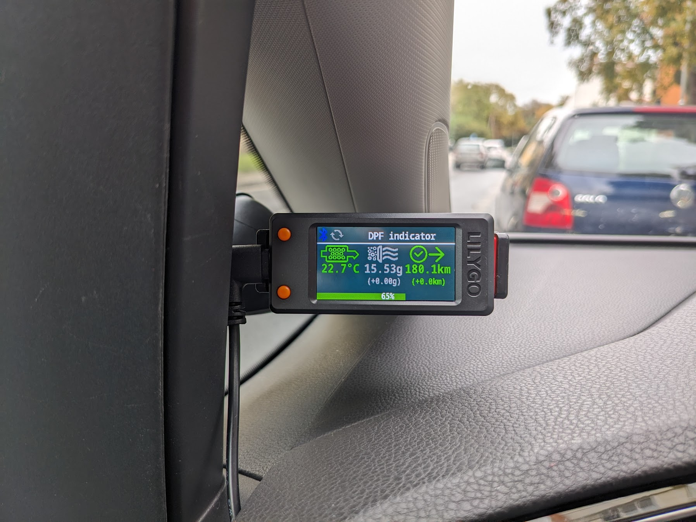
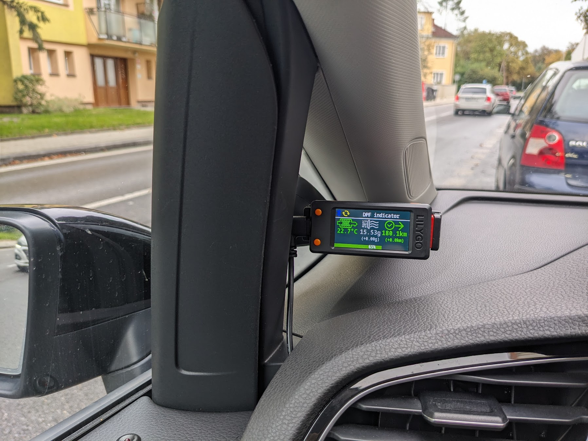

# VW DPF monitor
A little in-car device that shows the diesel particulate filter (DPF) status and sends the measurement log to Home Assistant when the car is parked at home.

## Main components
- LILYGO® [T-Display-S3](https://lilygo.cc/products/t-display-s3) ESP32-S3 1.9 inch ST7789 LCD Display Touch Screen Development Board
- Konnwei [KW901](https://www.konnwei.com/product/448.html) V1.5 Bluetooth 5 OBD2 Scanner ELM327 V1 OBDII auto car diagnostic tool

## Description
The device periodically reads the DPF status via OBD2/Bluetooth and shows the values on the display. It helps keep the DPF healthy by notifying you while a regeneration is in progress, so you don't switch the engine off in the middle of it.

Every measurement around a regeneration is stored in a log file in the device flash. When the car arrives within range of the home Wi-Fi, the device uploads the log to an MQTT broker, where Home Assistant picks it up automatically.

## Features
- Display the following values:
    - DPF gas input temperature (°C)
    - Soot mass calculated (g)
    - Distance from the last regeneration (km)
    - DPF fill level status (0-100%)
    - Oil ash residue (g) on the summary page
- Sound notification when the regeneration starts, a reminder beep every 30 s during it, and a notification when it ends
- Display the regeneration time
- Regeneration log stored in flash (LittleFS)
- Web interface on the device's own Wi-Fi access point: log table, download, delete, configuration
- Home Assistant integration over MQTT with auto-discovery: no YAML needed in Home Assistant

## Usage

### Buttons
| Action | Result |
|---|---|
| **Up** button | Switch to the summary page (returns to the main page after 8 s) |
| Hold **Down** button while powering on | Start in access-point mode only (no OBD measurement) |

### Wi-Fi behaviour
After start-up the device goes through these states:

1. **Client mode:** if the configured home Wi-Fi is in range, the device connects and uploads the log to MQTT / Home Assistant.
2. **Access-point mode:** after a successful upload, or after 10 s, or immediately when the home Wi-Fi is not in range, the device starts its own access point `DPF indicator`. Connect to it and open `http://192.168.4.1`.

Measuring over Bluetooth continues in both modes. While a phone or laptop is connected to the access point, the device does not try to reconnect a lost Bluetooth connection.

### Web interface (access-point mode)
| Page | Purpose |
|---|---|
| `/` | Log table (yellow rows = regeneration in progress, green = finished), with a delete link per row |
| `/download` | Download the raw log file (`measurements.log`) |
| `/deletelog` | Delete the whole log |
| `/config` | Home Wi-Fi SSID/password and MQTT server, port, user and password. Saving reboots the device. |

## Log file format
`/measurements.log` is a tab-separated file. The first line is the header; units are in brackets (`` ` `` stands for `°`). A typical regeneration produces three rows: start (soot ~24 g), end (~6 g, with the regeneration duration) and the state after it.

```
Regeneration  Distance driven (km)  Soot mass calculated (g)  Regeneration duration (min)  ...
1             114259                24.05                     0.0                          ...
1             114275                6.08                      14.0                         ...
0             114275                5.99                      0.0                          ...
```

Columns: Regeneration, Distance driven, Soot mass calculated, Regeneration duration, Distance since last regen., Time since last regen, Oil ash residue, Low press. EGR closing, Input temperature, Output temperature, Soot mass measured, Post injection 2, Post injection 3, Differential pressure.

## Home Assistant integration

### Requirements
- An MQTT broker reachable from the home network, e.g. Mosquitto. It must listen on the network interface, not only on `localhost`: for Mosquitto 2.x add `listener 1883 0.0.0.0`.
- The [MQTT integration](https://www.home-assistant.io/integrations/mqtt/) set up in Home Assistant.
- Optional: [flex-table-card](https://github.com/custom-cards/flex-table-card) from HACS for the log table.

### Setup
1. Hold **Down** while powering on, connect to the `DPF indicator` access point and open `http://192.168.4.1/config`.
2. Fill in the home Wi-Fi and MQTT broker details and save.
3. Next time the device sees the home Wi-Fi it uploads the log. The serial log shows `[MQTT] Upload CONFIRMED by broker`.
4. The device **Touran - DPF indicator** appears in Home Assistant under *Settings → Devices & services → MQTT*.

### What is sent on each upload
1. MQTT discovery messages for all entities (retained).
2. The **last** log row as sensor values to `touran/dpf/state` (retained). Only one row is sent, so the sensor history gets one point per upload rather than one per log row.
3. The **whole log file** as one retained message to `touran/dpf/log`. It is streamed, so its size is not limited by the MQTT client buffer.
4. A random marker to `touran/dpf/upload`. The device waits until the broker sends it back; only then is the upload reported as successful.

### MQTT topics
| Topic | Content | Retained |
|---|---|---|
| `homeassistant/<component>/touran/<object>/config` | Auto-discovery | yes |
| `touran/dpf/status` | `online` / `offline` (also the last will) | yes |
| `touran/dpf/state` | JSON with the values of the last log row | yes |
| `touran/dpf/log` | Whole log file (TSV) | yes |
| `touran/dpf/upload` | Upload confirmation marker | no |

### Entities
| Entity | Description |
|---|---|
| `sensor.touran_dpf_indicator_<column>` | One sensor per log column (soot, temperatures, distance, ash, …), value from the last row |
| `binary_sensor.touran_dpf_indicator_regeneration_active` | Regeneration in progress in the last row |
| `binary_sensor.touran_dpf_indicator_connected` | Device connected to the broker |
| `sensor.touran_dpf_indicator_last_upload` | Time of the last confirmed upload |
| `sensor.touran_dpf_indicator_log` | Number of log rows; the `rows` attribute holds the newest rows (newest first) for a table card |

All values are the **last known** state from when the car was last at home, not live data.

The `rows` attribute is limited to the newest 39 rows (`HA_LOG_ROWS` in `src/mqtt.h`), which keeps it under the 16 kB limit of the Home Assistant recorder. The full file is always available in the `touran/dpf/log` topic.

### Dashboard example
```yaml
type: vertical-stack
cards:
  - type: entities
    title: Touran – DPF status
    entities:
      - sensor.touran_dpf_indicator_last_upload
      - binary_sensor.touran_dpf_indicator_connected
      - binary_sensor.touran_dpf_indicator_regeneration_active
      - sensor.touran_dpf_indicator_soot_mass_calculated
      - sensor.touran_dpf_indicator_distance_since_last_regen
      - sensor.touran_dpf_indicator_oil_ash_residue
  - type: custom:flex-table-card
    title: Measurements (newest first)
    entities:
      include: sensor.touran_dpf_indicator_log
    columns:
      - { name: Regen, data: rows.regeneration, modify: "x == 1 ? '🔥' : ''" }
      - { name: km, data: rows.distance_driven }
      - { name: Soot (g), data: rows.soot_mass_calculated }
      - { name: Duration (min), data: rows.regeneration_duration }
      - { name: km since regen, data: rows.distance_since_last_regen }
      - { name: Ash (g), data: rows.oil_ash_residue }
      - { name: T in (°C), data: rows.input_temperature }
      - { name: T out (°C), data: rows.output_temperature }
      - { name: Δp (hPa), data: rows.differential_pressure }
```

### Troubleshooting
| Symptom | Cause |
|---|---|
| `connect(): socket error … errno: 104, "Connection reset by peer"` | Nothing accepts connections on the broker IP/port. The broker listens on `localhost` only, the port isn't published from Docker, a firewall blocks it, or the IP is wrong. |
| `[MQTT] connection failed (state=5)` | Wrong MQTT username or password |
| Entities stay `unavailable` | No retained data on `touran/dpf/state` yet. Check the topic with MQTT Explorer. |
| `Upload FAILED` | The broker did not echo the confirmation marker within 3 s. Check the broker log. |

## Build
PlatformIO project with two environments:

| Environment | Purpose |
|---|---|
| `lilygo_t_display_s3-debug` | Serial debug output (`DEBUG`), waits up to 3 s for the serial monitor |
| `lilygo_t_display_s3-release` | No serial wait |

```sh
pio run -e lilygo_t_display_s3-release -t upload
pio device monitor
```

Compile-time options in `src/config.h`: `TEST_MODE` (holding Down at boot simulates measurements every second), `SIMPLE_GUI` (text-only display).

## Notes
- The MQTT topics and the Home Assistant device are fixed to `touran/dpf` and *Touran - DPF indicator* in `src/mqtt.cpp`. The *Topic* field on the configuration page is stored but not used yet.
- The device access point is open (no password). It is started in `src/dpfmonitor.cpp` with `WifiServer::init("DPF indicator", "")`. Anyone in range can open the configuration page, so consider setting a password there.

 
 
